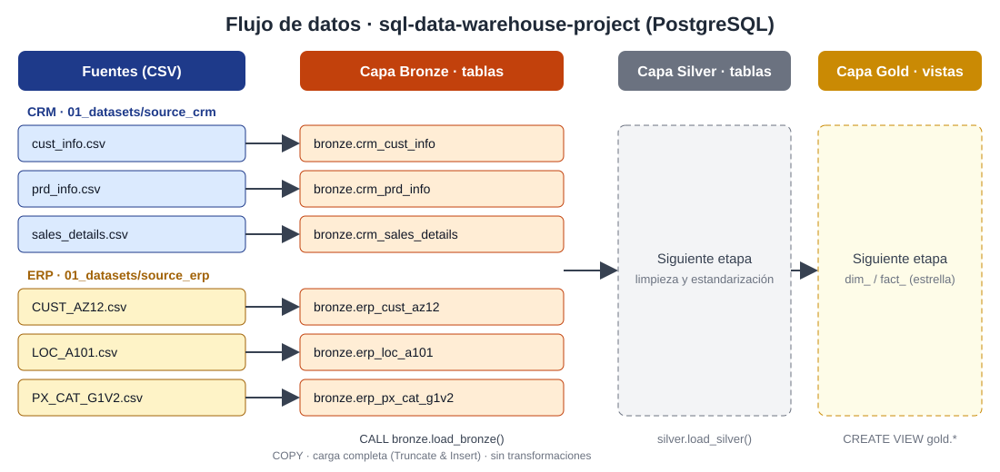

# Flujo de datos (Data Lineage)

Roadmap · Construir capa Bronze · **Documentación: Dibujar flujo de datos**.



## Versión en texto

```
 FUENTES (CSV)                        CAPA BRONZE                     CAPA SILVER        CAPA GOLD
 01_datasets/                         esquema bronze (tablas)         (tablas)           (vistas)
 ---------------------------------    ----------------------------    --------------     --------------
 source_crm/cust_info.csv      ──►    bronze.crm_cust_info       ──►
 source_crm/prd_info.csv       ──►    bronze.crm_prd_info        ──►  siguiente          siguiente
 source_crm/sales_details.csv  ──►    bronze.crm_sales_details   ──►  etapa              etapa
 source_erp/CUST_AZ12.csv      ──►    bronze.erp_cust_az12       ──►
 source_erp/LOC_A101.csv       ──►    bronze.erp_loc_a101        ──►
 source_erp/PX_CAT_G1V2.csv    ──►    bronze.erp_px_cat_g1v2     ──►

          CALL bronze.load_bronze()            silver.load_silver()      CREATE VIEW gold.*
          COPY, Truncate & Insert              (pendiente)               (pendiente)
```

## Características de cada capa (diapositiva 6)

| | Bronze | Silver | Gold |
|---|---|---|---|
| Definición | Datos sin procesar, tal como llegan | Datos limpios y estandarizados | Datos listos para el negocio |
| Objetivo | Trazabilidad y depuración | Preparar los datos para el análisis | Reportes y análisis |
| Tipo de objeto | Tablas | Tablas | **Vistas** |
| Método de carga | Carga completa (Truncate & Insert) | Carga completa (Truncate & Insert) | No aplica |
| Transformación | Ninguna | Limpieza, estandarización, normalización, columnas derivadas, enriquecimiento | Integración, agregación, reglas de negocio |
| Modelado | Ninguno | Ninguno | Esquema en estrella, tablas planas, agregados |
| Público | Ingenieros de datos | Analistas e ingenieros de datos | Analistas y usuarios de negocio |

## Dos aclaraciones sobre el material de la clase

- **Gold se hace con vistas.** El diagrama de la diapositiva 7 dibuja un procedimiento almacenado también en Gold, pero la tabla de la diapositiva 6 dice "Tipo de objeto: Vistas" y "Método de carga: No aplica". Seguimos la tabla: Gold son vistas (`CREATE VIEW`), que no se cargan, se calculan al consultarlas.
- **Los nombres van en inglés.** Algunos ejemplos de la teoría usan nombres en español, pero el documento de convenciones pide inglés y `snake_case` (por ejemplo `gold.dim_customers`, `gold.fact_sales`).

## Implementación

- Motor: **PostgreSQL** (el pptx usa SQL Server; `BULK INSERT` → `COPY`, `CREATE OR ALTER PROCEDURE` → `CREATE OR REPLACE PROCEDURE ... LANGUAGE plpgsql`).
- Una sola base `data_warehouse` con los esquemas `bronze`, `silver` y `gold`.
