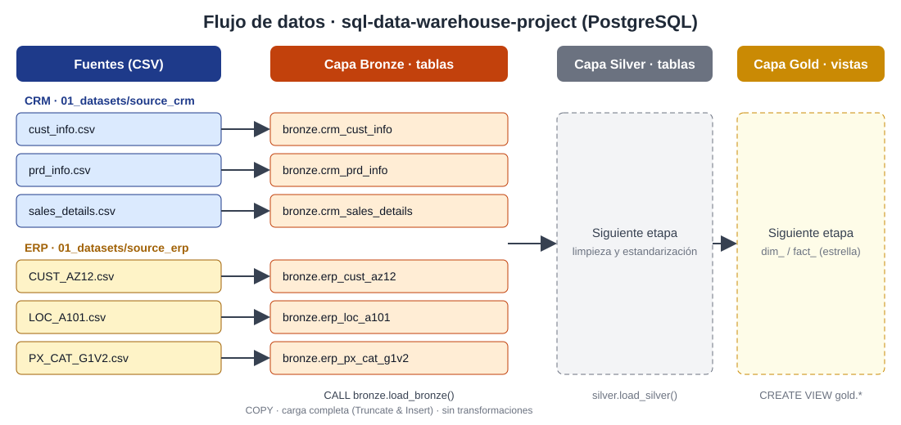

# sql-data-warehouse-project

ISW-623 Bases de Datos Avanzadas · Clase 09 · Arquitectura Medallion (ejercicio).
Universidad Técnica Nacional, Sede San Carlos · Brandon Prado Mora.

Almacén de datos en **PostgreSQL** que consolida las ventas de dos sistemas de origen (CRM y ERP), entregados como archivos CSV, organizado en las capas Bronze, Silver y Gold.

| Capa | Estado | Qué contiene |
|---|---|---|
| Bronze | ✅ Completa | 6 tablas con los datos tal como llegan, cargadas con `COPY` por `bronze.load_bronze()` |
| Silver | ✅ Completa | 6 tablas limpias y estandarizadas, cargadas desde Bronze por `silver.load_silver()` |
| Gold | ⏳ Siguiente etapa | Vistas en esquema estrella |



## Estructura

```
sql-data-warehouse-project/
├── 00_setup/          Guía de configuración y orden de ejecución.
├── 01_datasets/       Los seis archivos de origen.
│   ├── source_crm/    cust_info.csv, prd_info.csv, sales_details.csv
│   └── source_erp/    CUST_AZ12.csv, LOC_A101.csv, PX_CAT_G1V2.csv
├── 02_docs/           Requisitos, convenciones, análisis, reglas de Silver y flujo de datos.
├── 03_scripts/
│   ├── init_database.sql              Crea la BD y los esquemas. Ejecutar primero.
│   ├── bronze/
│   │   ├── 01_ddl_bronze.sql          CREATE TABLE de las 6 tablas Bronze.
│   │   ├── 02_load_bronze_copy.sql    COPY para probar la carga.
│   │   └── 03_proc_load_bronze.sql    Procedimiento bronze.load_bronze()
│   ├── silver/
│   │   ├── 01_ddl_silver.sql          CREATE TABLE de las 6 tablas Silver.
│   │   └── 02_proc_load_silver.sql    Procedimiento silver.load_silver()
│   └── gold/          (siguiente etapa)
└── 04_tests/
    ├── quality_checks_bronze.sql      Conteo de filas y columnas de Bronze.
    └── quality_checks_silver.sql      Chequeos de calidad de Silver (todo en 0).
```

## Orden de ejecución

Ver [00_setup/README.md](00_setup/README.md). Resumen:

1. `03_scripts/init_database.sql` (parte 1 sobre la base `postgres`, parte 2 sobre `data_warehouse`)
2. `03_scripts/bronze/01_ddl_bronze.sql` → `03_proc_load_bronze.sql` → `CALL bronze.load_bronze();`
3. `04_tests/quality_checks_bronze.sql`
4. `03_scripts/silver/01_ddl_silver.sql` → `02_proc_load_silver.sql` → `CALL silver.load_silver();`
5. `04_tests/quality_checks_silver.sql`

## Documentación

| Archivo | Contenido |
|---|---|
| [project_requirements.md](02_docs/project_requirements.md) | Objetivo y especificaciones |
| [naming_conventions.md](02_docs/naming_conventions.md) | Convenciones de nomenclatura |
| [source_analysis.md](02_docs/source_analysis.md) | Qué trae cada CSV, relaciones y problemas de calidad |
| [silver_transformations.md](02_docs/silver_transformations.md) | Reglas de limpieza y estandarización de Silver |
| [data_flow.md](02_docs/data_flow.md) | Flujo de datos entre capas |

## Decisiones de diseño

- **PostgreSQL en lugar de SQL Server.** El pptx está escrito para SQL Server; equivalentes usados: `BULK INSERT` → `COPY`, `CREATE OR ALTER PROCEDURE` → `CREATE OR REPLACE PROCEDURE ... LANGUAGE plpgsql`, `EXEC` → `CALL`.
- **Una sola base (`data_warehouse`) con tres esquemas** (`bronze`, `silver`, `gold`). En PostgreSQL una consulta no puede leer tablas de otra base sin extensiones (`dblink`, `postgres_fdw`), y Silver necesita leer de Bronze.
- **Carga completa (Truncate & Insert)** en Bronze y Silver: el alcance pide solo el dato más reciente, sin historial.
- **Columna técnica `dwh_create_date`** en Silver, según la convención `dwh_<column_name>`.
- **Gold se implementará con vistas** (diapositiva 6) y todos los nombres van en inglés.
- **Los CSV se versionan en el repositorio.** Son unos 5 MB y los scripts los necesitan.
